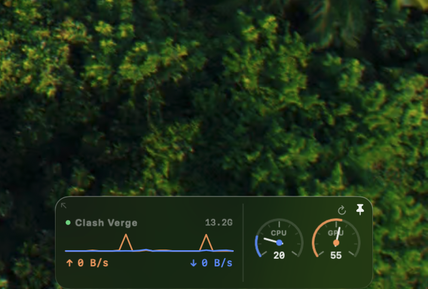

# 码表 SysMon

桌面右下角的小码表：Clash Verge 实时网速 / CPU / GPU / 内存 / 谁在吃 CPU。

外观：**深色透明磨砂玻璃**（NSVisualEffectView `hudWindow` + `darkAqua` + 10% 黑色底），文字用白色，透得过背景但看得清。

## 现在的位置

装好的 App 在 `/Applications/码表.app`，源码在本文件夹。
已加进「登录项」，开机自动起（`~/Library/LaunchAgents` 里没有，是系统登录项）。

## 操作

| 动作 | 结果 |
|---|---|
| 点**网速区**（曲线/上下行数字） | 打开 Clash Verge |
| 点**表盘** | 向上展开「谁在吃 CPU」（前 6 名） |
| 点进程行右边的 **×** | 结束该进程（有确认框） |
| 拖左上角的小箭头 | 缩放（往左上=变大，往右下=变小，0.6–2.0 倍） |
| 点 **↻** | 立刻重新采样 |
| 点 **📌** | 切换是否固定在最上层 |

菜单栏图标里也有「放大 / 缩小 / 实际大小」。缩放比例和位置都存在 UserDefaults（`panelScale` / `panelOrigin`），重启后保持。

面板浮在屏幕右下角（离屏幕底 96pt，给 Dock 让位）。可以拖，位置会记住；菜单栏「回到右下角」一键归位。

**主体面板永远 268×78，点开明细不改尺寸** —— 明细是独立的第二个窗口，浮在面板上方 6pt，所以点开时面板一个像素都不会动。

## 数据来源

| 指标 | 来源 |
|---|---|
| ↑ ↓ 流量 | Clash Verge 的 mihomo 接口 `/connections`（unix socket），取 `downloadTotal/uploadTotal` 每秒差分 |
| CPU | `host_statistics(HOST_CPU_LOAD_INFO)` 差分 |
| GPU | IOKit `IOAccelerator` → `PerformanceStatistics["Device Utilization %"]` |
| 内存 | `host_statistics64` active + wired + compressed |
| 进程排行 | `/bin/ps -A -o pcpu=,pid=,comm=` 同名合并 |

socket 路径：`/var/run/clash-verge-service/users/501/verge-mihomo.sock`
（要 Clash Verge 开着「服务模式」）

## 改

改 `Sources/main.swift` → 跑 `./build.sh`（会自动装到 /Applications 并重启）。

配色：`cUp` 橙＝上行/GPU，`cDown` 蓝＝下行/CPU。
尺寸：`AppDelegate` 的 `W`/`H`（收起 78，展开 186）。

## 注意

- 没有「一键释放 CPU/GPU」这种东西 —— 占用是正在跑的进程决定的，
  想降只能把程序关掉，或者等它跑完。× 就是干这个的。
- 抓不到流量时看 `/tmp/sysmon-debug.log`（只有失败才写）。

## 图标

源图 `assets/logo.jpg`（黑线稿）→ `tools/mkicon.py` 生成黑底白线 / 白底黑线两版：

- `assets/icon-dark.png`（黑底，正式用）
- `assets/icon-preview.png`（白底，备用）

生图后跑 `./build.sh` 会自动打包成 `AppIcon.icns`。换图就替换 `assets/logo.jpg` + 删掉 `build/AppIcon.icns` 后重新构建。
